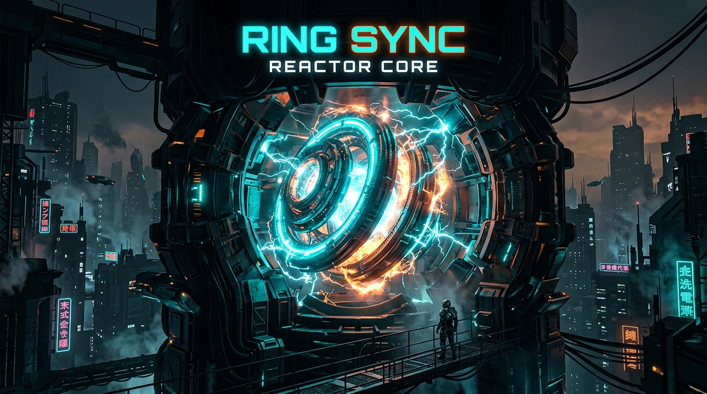

# ⚡ Ring Sync: Reactor Core

[](https://github.com/leonardoconstantino/ring-sync-reactor-core/actions/workflows/deploy.yml)
[](https://react.dev/)
[](https://www.typescriptlang.org/)
[](https://vitejs.dev/)
[](https://tailwindcss.com/)
[](LICENSE)

> **Jogo de precisão e ritmo cyberpunk.** Estabilize reatores de contenção e geradores urbanos à beira do colapso travando anéis giratórios no momento exato antes de um apagão total da rede elétrica.

---

### 🎮 [JOGAR AGORA (ONLINE PREVIEW)](https://leonardoconstantino.github.io/ring-sync-reactor-core/)

Acesse a versão final diretamente no navegador (sem necessidade de instalação):  
👉 **https://leonardoconstantino.github.io/ring-sync-reactor-core/**

---

## 📸 Visão Geral



---

## 🌟 Principais Recursos

- **Mecânica Central de Sincronia de Anéis**:
  - Conjuntos de 2 a 6 anéis concêntricos com rotação horária e anti-horária independente.
  - Zonas de tolerância angular (*Snap Gates*) que exigem reflexos e precisão milimétrica.
  - Renderizador desacoplado em **Canvas 2D** a 60 FPS com arquitetura limpa em camadas.

- **Sistema Dinâmico de Pressão (Pressure System)**:
  - Quanto mais você hesita, mais rápido os anéis aceleram:  
    `velocidade = velocidade_base × (1 + fator_pressão × tempo_decorrido)`.
  - Temperatura do reator sobe com erros; 3 falhas ou 100% de calor resultam em *Meltdown*.

- **Multiplicadores de Combo e Descargas Elétricas**:
  - Trave anéis ritmicamente em sequência para desbloquear multiplicadores $\times 1.5$, $\times 2.0$ e até $\times 3.0$.
  - Efeitos visuais de arcos voltaicos conectando os anéis sincronizados ao núcleo central.

- **Dilatação Temporal (Slow Motion)**:
  - Ative desaceleração temporal para reduzir a velocidade para $0.3\times$ por 3 segundos.
  - Filtro sonoro *low-pass* em tempo real e partículas suspensas.
  - Concluir fases sem utilizar o slow-motion concede **+25% de bônus de pontuação**.

- **5 Setores Industriais & 30 Fases**:
  - **Setor 01 — Substation Delta**: Introdução à calibragem e Chefão *Ghost Calibrator* (portas camufladas).
  - **Setor 02 — Cooling Grid-7**: Turbinas criogênicas e Chefão *Vortex Invertor* (inversão espontânea de rotação).
  - **Setor 03 — Reactor Core Nv.3**: Alta radiação e Chefão *Cipher Core* (telemetria embaralhada).
  - **Setor 04 — City Grid Omega**: Tempestades de arcos elétricos e Chefão *Phantom Mirror* (anéis espelho fantasma).
  - **Setor 05 — The Last Mainframe**: Apagamento digital e Chefão *Total Collapse* (todas as anomalias combinadas).

- **Modo Infinito: Overload Survival**:
  - Ondas ininterruptas com anéis gerados proceduralmente e aceleração contínua.
  - Tabela de recordes locais persistida com a maior onda alcançada.

- **Sintetizador de Áudio Procedural (Web Audio API)**:
  - Cliques mecânicos hidráulicos realistas, acordes harmônicos cristalinos ascendentes por combo e queda de subgrave no game over.
  - Sem arquivos pesados de áudio externo — 100% sintetizado em tempo real.

- **Acessibilidade e Ajustes**:
  - *Touch Assist* para telas touch (+2.5° de tolerância).
  - Controle de *Screen Shake* (tremores de câmera).
  - Modo de *Reduced Motion* e telemetria de ângulos numéricos em graus.

---

## 🕹️ Controles

| Ação | Teclado | Mouse / Touch |
|---|---|---|
| **Travar Anel Ativo (Lock Ring)** | `Barra de Espaço` | Clique no canvas ou botão `LOCK ACTIVE RING` |
| **Dilatação Temporal (Slow-Mo)** | Tecla `S` ou `Shift` | Botão `SLOW-MO [S]` no HUD |
| **Pausar Operações** | Tecla `Esc` ou `P` | Botão de pausa no topo direito |
| **Reinício Rápido (Restart)** | Tecla `R` | Botão Recalibrate no modal |
| **Alternar Áudio (Mute)** | Botão de som no topo | Ícone de volume no cabeçalho |

---

## 🚀 Como Rodar Localmente

### Pré-requisitos
- [Node.js](https://nodejs.org/) versão 18 ou 20+
- Gerenciador de pacotes `npm` ou `bun`

### Passo a Passo

1. **Clone o repositório:**
   ```bash
   git clone https://github.com/leonardoconstantino/ring-sync-reactor-core.git
   cd ring-sync-reactor-core
   ```

2. **Instale as dependências:**
   ```bash
   npm install
   ```

3. **Inicie o servidor de desenvolvimento:**
   ```bash
   npm run dev
   ```
   Abra seu navegador em [http://localhost:3000](http://localhost:3000).

4. **Gerar build de produção:**
   ```bash
   npm run build
   ```

5. **Testar preview da build:**
   ```bash
   npm run preview
   ```

---

## 🔄 Deploy Automático via GitHub Actions

Este repositório possui uma pipeline CI/CD pré-configurada em `.github/workflows/deploy.yml`:

1. A cada **push** nas branches `main` ou `master` (ou acionamento manual em *Actions*):
   - O GitHub Actions provisiona um ambiente com **Node.js 20**.
   - Instala as dependências.
   - Executa `npm run build` injetando a flag `GITHUB_ACTIONS=true` para ajustar automaticamente o caminho base no Vite (`/ring-sync-reactor-core/`).
   - Faz o upload do pacote `dist/` gerado e publica instantaneamente no **GitHub Pages**.

---

## ⚙️ Configuração Única no GitHub (Checklist)

Para ativar a publicação automática na sua conta do GitHub:

1. Acesse o repositório no GitHub: `https://github.com/leonardoconstantino/ring-sync-reactor-core`
2. Vá em **Settings** (Configurações) > **Pages** (no menu lateral esquerdo).
3. Na seção **Build and deployment**:
   - Em **Source**, selecione **GitHub Actions** (em vez de *Deploy from a branch*).
4. Faça o push do seu código para a branch `main`:
   ```bash
   git add .
   git commit -m "feat: setup GitHub Actions automated deployment and documentation"
   git push origin main
   ```
5. Acompanhe a execução na aba **Actions**. Assim que o workflow concluir com sucesso, o jogo estará no ar em:  
   👉 **https://leonardoconstantino.github.io/ring-sync-reactor-core/**

---

## 📄 Licença

Distribuído sob a licença [MIT](LICENSE). Desenvolvido por [Leonardo Constantino](https://github.com/leonardoconstantino).
